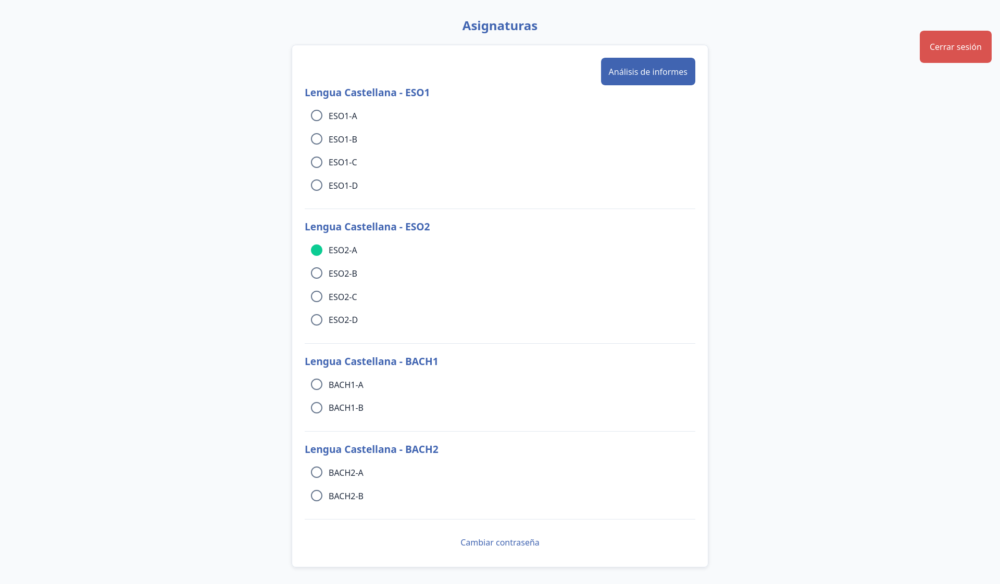
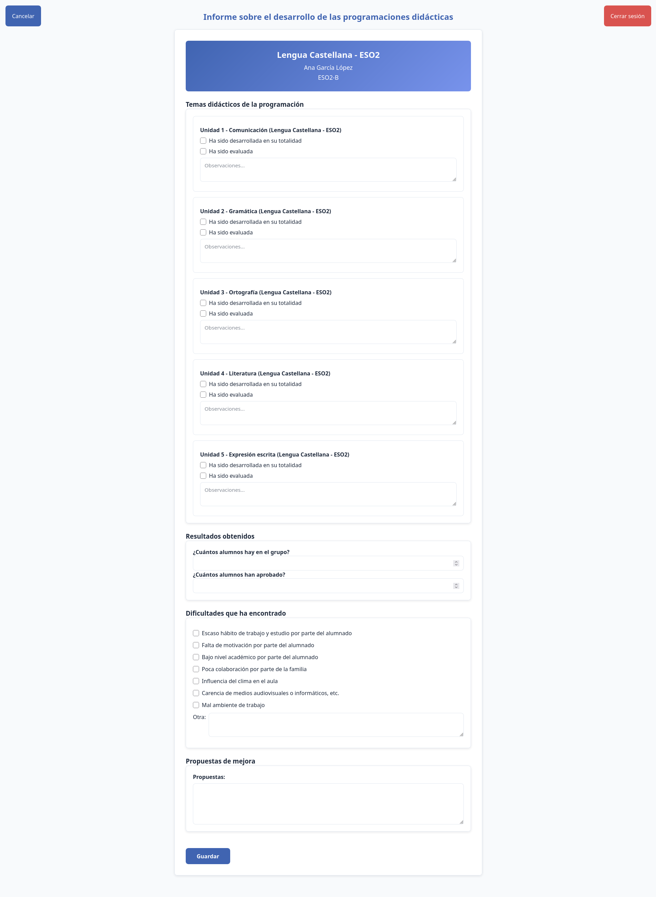
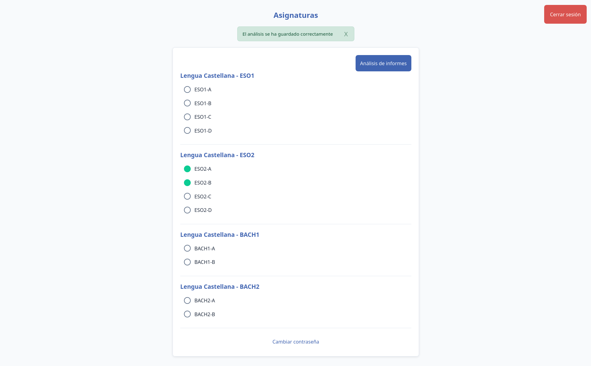
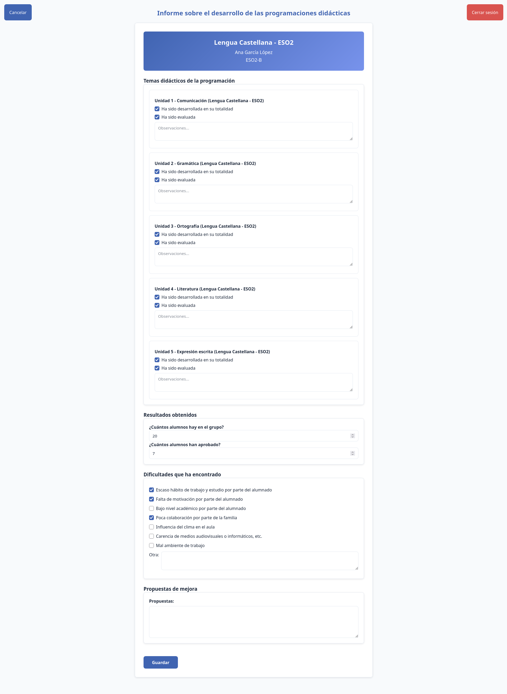
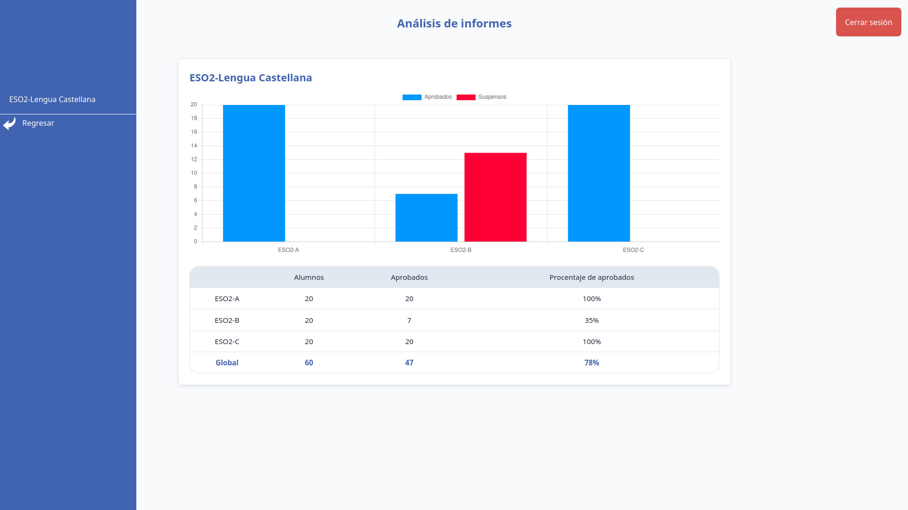
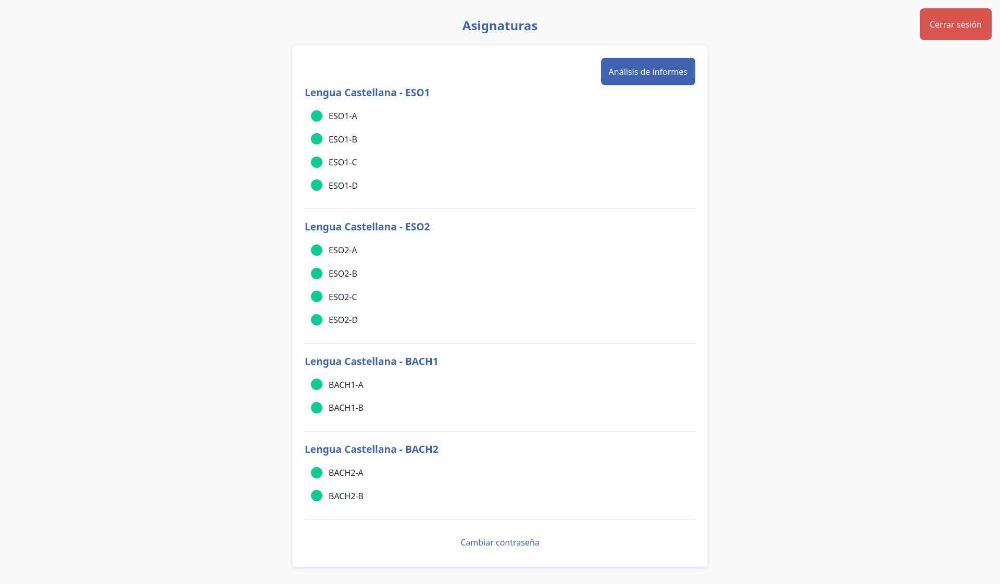
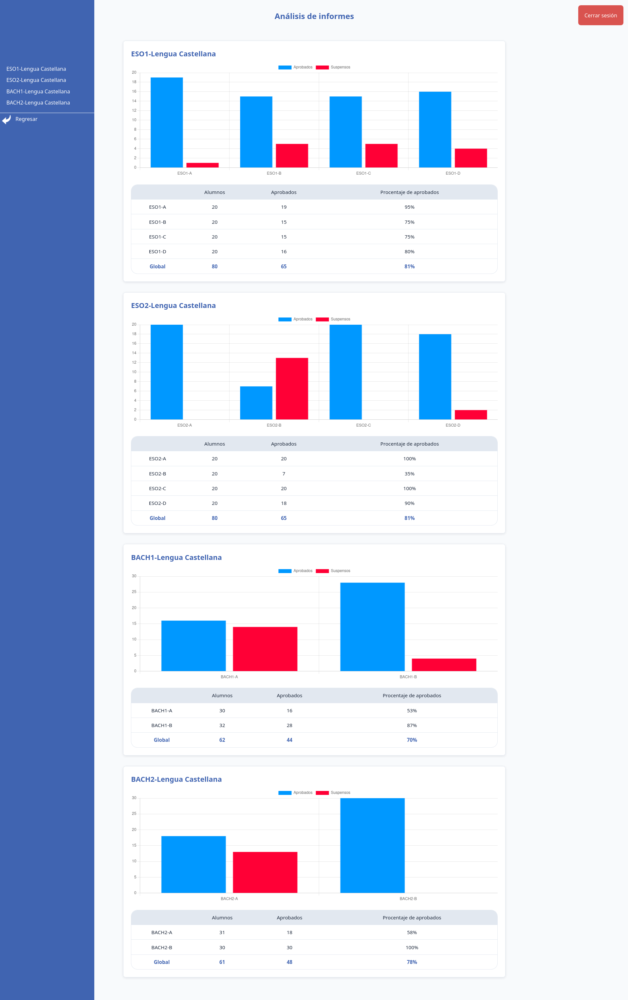
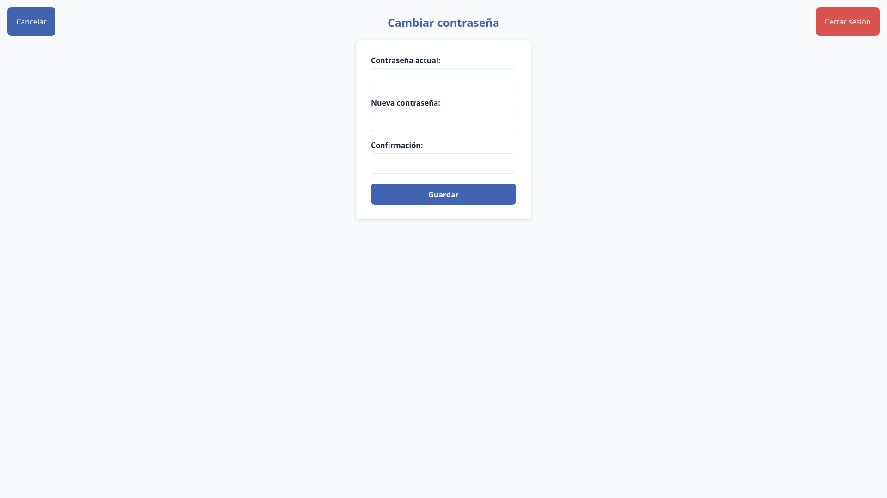

# Manual de uso

Esta aplicación permite a los docentes registrar los resultados académicos de sus alumnos por asignatura y grupo. A partir de los datos introducidos, se pueden consultar el número de alumnos aprobados y suspensos, así como visualizar informes gráficos de los resultados.

## Índice

- [ADMINISTRADOR](#administrador)
  - [Inicio de sesión](#inicio-de-sesión)
  - [Secciones de la aplicación](#secciones-de-la-aplicación)
  - [Formulario de grupo](#formulario-de-grupo)
  - [Guardado y edición de resultados](#guardado-y-edición-de-resultados)
  - [Análisis de informes](#análisis-de-informes)
  - [Cambio de contraseña](#cambio-de-contraseña)
- [USUARIO](#usuario)

## ADMINISTRADOR

### Inicio de sesión

Al acceder a la aplicación, se muestra la pantalla de inicio de sesión. En ella, el administrador debe introducir sus credenciales para acceder a las funciones de gestión.

**Usuario**

```text
angalo
```

**Contraseña**

```text
123
```

Una vez iniciada la sesión, se mostrará la pantalla principal de la aplicación.

### Secciones de la aplicación

La pantalla principal presenta un menú de selección en el que se pueden consultar las asignaturas, los cursos y los grupos disponibles del docente con el que se ha iniciado sesión.

Desde aquí, el administrador puede seleccionar el grupo del que desea registrar o consultar los resultados.



Cada grupo aparece organizado según su asignatura y curso. Al seleccionar uno de ellos, se accede al formulario correspondiente para registrar los resultados.

### Formulario de grupo

Al hacer clic en uno de los grupos mostrados, se abrirá el formulario de resultados de dicho grupo.

Por ejemplo, al seleccionar el grupo **ESO2-B** de la asignatura **Lengua Castellana – ESO 2**, se mostrará el siguiente formulario:



El formulario está dividido en las siguientes secciones:

- **Temas didácticos de la programación**
- **Resultados obtenidos**
- **Dificultades encontradas**
- **Propuestas de mejora**

Los campos **número de alumnos del grupo** y **alumnos aprobados** son obligatorios. El resto de campos son opcionales, aunque se recomienda completarlos para obtener un informe más completo.

En la esquina superior izquierda se encuentra el botón para cancelar la resolución del formulario y volver a la pantalla anterior sin guardar los cambios.

### Guardado y edición de resultados

Una vez completados los campos necesarios, se debe pulsar el botón **Guardar**. De esta forma, los resultados del formulario se añaden a la base de datos y la aplicación vuelve automáticamente a la pantalla anterior.



Cuando los resultados de un grupo han sido guardados, el círculo situado a la izquierda del grupo aparece en color verde. Esto indica que el formulario correspondiente ya ha sido completado.

Para revisar la información guardada, basta con volver a acceder al formulario del grupo. La aplicación mostrará todos los datos que fueron registrados anteriormente.



Si se desea modificar algún dato, solo hay que seleccionar el campo correspondiente, actualizar su contenido y volver a pulsar **Guardar**.

### Análisis de informes

Para consultar un análisis general de los alumnos aprobados, hay que pulsar el botón **Análisis de informes**, situado en la esquina superior derecha de la pantalla principal.

En esta sección se muestran gráficas con el número de alumnos aprobados y suspensos por grupo, organizadas según la asignatura y el curso correspondiente.



En este ejemplo, solo se han registrado los resultados de tres grupos, por lo que únicamente aparecen sus datos en las gráficas.

A medida que se registren más formularios, los nuevos resultados se irán añadiendo automáticamente al análisis:

- Si el grupo pertenece a una asignatura ya representada, se añadirán nuevas barras a la gráfica correspondiente.
- Si el grupo pertenece a una asignatura nueva, se creará una gráfica adicional.

Así se vería el menú de selección cuando todos los grupos han sido completados:



Y esta sería la vista completa de los análisis:



Para facilitar la navegación entre asignaturas, se puede utilizar el menú lateral. También es posible regresar a la sección anterior en cualquier momento.

### Cambio de contraseña



En esta pantalla se puede modificar la contraseña del usuario que ha iniciado sesión.

Esta opción no está habilitada en la versión de demostración.

## USUARIO

En la versión actual de la aplicación, las funciones disponibles para el usuario y el administrador son prácticamente las mismas.

No obstante, se incluye un usuario de muestra por si se desea acceder con un perfil distinto:

**Usuario**

```text
lumasa
```

**Contraseña**

```text
123
```